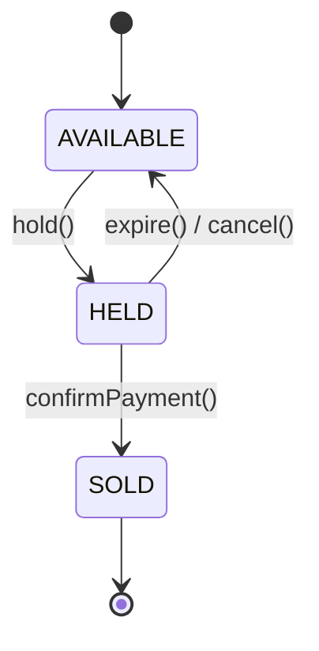
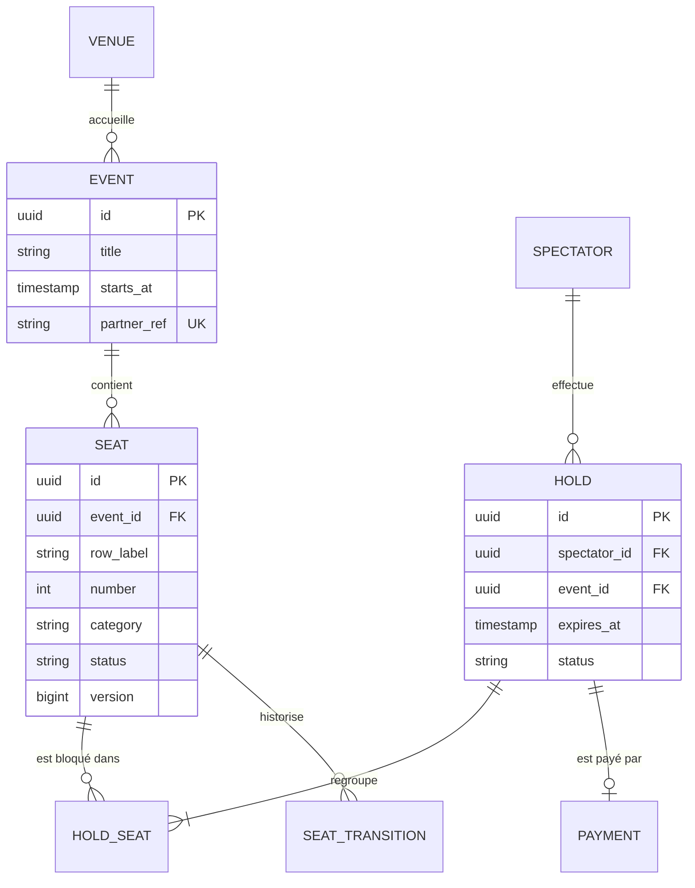

# Sujet de projet — **SeatRush**
### Plateforme de billetterie à forte concurrence
**Java 21 · Spring Boot · JPA/Hibernate · Architecture hexagonale · Angular**

---

## 1. Contexte

SeatRush est une plateforme de vente de places pour des concerts et événements. Deux moments sont critiques :

1. **L'ouverture des ventes** : des milliers d'utilisateurs tentent de réserver les mêmes sièges au même instant. Un siège ne doit **jamais** être vendu deux fois.
2. **La synchronisation du catalogue** : les événements proviennent de plusieurs partenaires externes (salles, tourneurs) dont les API sont lentes et parfois indisponibles. Le catalogue doit être agrégé rapidement, en parallèle, sans bloquer l'application.

Ce contexte métier a été choisi parce qu'il rend **naturellement nécessaires** chacun des sujets techniques à maîtriser : concurrence, verrouillage en base, isolation du domaine, temps réel côté front.

---

## 2. Objectifs pédagogiques

À la fin du projet, le développeur doit savoir :

| Sujet | Compétence visée |
|---|---|
| **Java 21** | Utiliser à bon escient les threads virtuels, records, sealed types, pattern matching (`switch` + record patterns), sequenced collections, et comprendre les API en preview (Structured Concurrency, Scoped Values) |
| **Multithreading** | Paralléliser des appels I/O, gérer la contention sur une ressource partagée, éviter le *pinning* des threads virtuels, écrire un test de concurrence déterministe |
| **Hexagonale** | Isoler un domaine métier pur, définir des ports entrants/sortants, écrire des adaptateurs interchangeables, faire respecter les règles de dépendance par des tests |
| **JPA / Hibernate** | Mapper un modèle relationnel, gérer le verrouillage optimiste et pessimiste, éviter le N+1, utiliser des projections en records, versionner le schéma |
| **Spring** | Configurer Spring Boot avec les threads virtuels, exposer une API REST propre (ProblemDetail), consommer des API externes (RestClient), pousser des événements en temps réel (SSE), observer l'application (Actuator) |
| **Angular** | Construire une application en composants standalone, gérer l'état avec les **signals**, utiliser le nouveau control flow (`@if`, `@for`, `@defer`), consommer un flux SSE |

---

## 3. Stack technique imposée

| Couche | Technologie | Version minimale |
|---|---|---|
| Langage | Java | **21** (LTS) |
| Framework | Spring Boot | 3.2+ (support natif des threads virtuels) |
| ORM | Hibernate | 6.x (fourni par Spring Boot) |
| Base de données | PostgreSQL | 15+ |
| Migrations | Flyway | — |
| Build | Maven multi-modules | — |
| Tests back | JUnit 5, AssertJ, Testcontainers, ArchUnit, WireMock | — |
| Front | Angular | 17+ (standalone, signals, control flow) |
| Conteneurisation | Docker Compose | — |

> ⚠️ Les API **Structured Concurrency** et **Scoped Values** sont en *preview* dans Java 21. Elles nécessitent `--enable-preview` à la compilation, aux tests et à l'exécution. Leur API a évolué dans les versions suivantes de Java : le code écrit ici est pédagogique et devra être adapté lors d'une montée de version.

---

## 4. Périmètre fonctionnel

### 4.1 Acteurs

- **Spectateur** : consulte les événements, réserve des sièges, paie.
- **Administrateur** : déclenche la synchronisation du catalogue partenaires, suit les ventes en temps réel.

### 4.2 User stories

| ID | En tant que… | Je veux… | Afin de… |
|---|---|---|---|
| US-01 | Spectateur | voir la liste des événements à venir, filtrable par ville et date | trouver un événement |
| US-02 | Spectateur | voir le plan de salle avec l'état de chaque siège (libre / bloqué / vendu) **mis à jour en temps réel** | choisir mes places |
| US-03 | Spectateur | bloquer 1 à 6 sièges pendant **5 minutes** | avoir le temps de payer |
| US-04 | Spectateur | payer ma réservation (paiement simulé) | recevoir mes billets |
| US-05 | Spectateur | voir un compte à rebours de ma réservation | savoir combien de temps il me reste |
| US-06 | Système | libérer automatiquement les sièges bloqués expirés | les remettre en vente |
| US-07 | Admin | lancer la synchronisation des catalogues de 3 partenaires | alimenter le catalogue |
| US-08 | Admin | voir la progression et le résultat de chaque synchronisation (succès, partenaires en échec, durée) | diagnostiquer |
| US-09 | Admin | voir un tableau de bord des ventes en direct (sièges vendus, taux de remplissage) | piloter l'événement |

### 4.3 Règles métier

- **RG-01** : un siège ne peut être vendu qu'une seule fois (invariant absolu).
- **RG-02** : un blocage (*hold*) expire après 5 minutes ; au-delà, les sièges redeviennent libres.
- **RG-03** : un spectateur ne peut avoir qu'un seul blocage actif par événement.
- **RG-04** : maximum 6 sièges par blocage.
- **RG-05** : la synchronisation partenaires a un **délai global de 3 secondes** ; un partenaire trop lent est ignoré sans faire échouer les autres (selon la stratégie choisie, voir §6.2).
- **RG-06** : le prix d'un siège dépend de sa catégorie (`STANDARD`, `PREMIUM`, `VIP`) et d'une éventuelle remise (`EARLY_BIRD`, `GROUP` à partir de 4 sièges).

### 4.4 Cycle de vie d'un siège



---

## 5. Architecture hexagonale

### 5.1 Principe

Le **domaine** est au centre et ne dépend de rien (ni Spring, ni JPA, ni Jackson). Il expose des **ports entrants** (cas d'usage) et déclare des **ports sortants** (interfaces vers la persistance, les partenaires, les notifications). Les **adaptateurs** implémentent ces ports à l'extérieur.

```
                    ┌──────────────────────────────────────────┐
   Angular ──HTTP──▶│ adapter-rest (in)                        │
   Angular ◀──SSE───│ adapter-sse  (out: NotificationPort)     │
                    │        │                                 │
                    │        ▼                                 │
                    │ ┌──────────────────────────────────────┐ │
                    │ │ application                          │ │
                    │ │  ports in : HoldSeatsUseCase, ...    │ │
                    │ │  ports out: SeatRepository, ...      │ │
                    │ │ ┌──────────────────────────────────┐ │ │
                    │ │ │ domain (Java pur)                │ │ │
                    │ │ │ Event, Seat, Hold, Price, ...    │ │ │
                    │ │ └──────────────────────────────────┘ │ │
                    │ └──────────────────────────────────────┘ │
                    │        │                     │           │
                    │        ▼                     ▼           │
                    │ adapter-persistence-jpa  adapter-partners│
                    └────────│─────────────────────│───────────┘
                             ▼                     ▼
                         PostgreSQL        API partenaires (WireMock)
```

### 5.2 Découpage Maven imposé

```
seatrush/
├── pom.xml                              (parent)
├── seatrush-domain/                     Java pur — AUCUNE dépendance externe
├── seatrush-application/                ports + services applicatifs — dépend de domain uniquement
├── seatrush-adapter-rest/               contrôleurs Spring MVC, DTO, mapping
├── seatrush-adapter-persistence-jpa/    entités JPA, repositories Spring Data, mappers
├── seatrush-adapter-partners/           clients HTTP partenaires (RestClient)
├── seatrush-adapter-sse/                diffusion temps réel
├── seatrush-bootstrap/                  @SpringBootApplication, configuration, câblage des beans
└── seatrush-web/                        application Angular
```

### 5.3 Organisation des packages

```
com.seatrush.domain
 ├── event        Event, EventId, Venue
 ├── seat         Seat, SeatId, SeatStatus, SeatCategory
 ├── hold         Hold, HoldId, HoldPolicy
 ├── pricing      Price, PricingPolicy, Discount (sealed)
 └── shared       DomainException, Clock abstraction

com.seatrush.application
 ├── port.in      HoldSeatsUseCase, ConfirmPaymentUseCase, SyncCatalogUseCase, ...
 ├── port.out     SeatRepository, HoldRepository, PartnerCatalogPort, SeatNotificationPort, ...
 └── service      HoldSeatsService, SyncCatalogService, ExpireHoldsService, ...
```

### 5.4 Règles à respecter (vérifiées par ArchUnit)

1. `domain` ne dépend d'aucun package `org.springframework..`, `jakarta.persistence..`, `com.fasterxml..`.
2. `application` ne dépend que de `domain` (et de `java..`).
3. Les adaptateurs ne se connaissent pas entre eux.
4. Les entités JPA (`*JpaEntity`) ne sortent **jamais** de l'adaptateur de persistance : un mapper les convertit en objets du domaine.
5. Les services applicatifs ne portent pas d'annotation Spring : ils sont déclarés en `@Bean` dans `seatrush-bootstrap`.

```java
@AnalyzeClasses(packages = "com.seatrush")
class HexagonalArchitectureTest {

    @ArchTest
    static final ArchRule domain_is_pure = noClasses()
        .that().resideInAPackage("..domain..")
        .should().dependOnClassesThat()
        .resideInAnyPackage("org.springframework..", "jakarta.persistence..", "com.fasterxml..");

    @ArchTest
    static final ArchRule application_depends_only_on_domain = classes()
        .that().resideInAPackage("..application..")
        .should().onlyDependOnClassesThat()
        .resideInAnyPackage("..application..", "..domain..", "java..");
}
```

### 5.5 Point de décision à documenter (ADR)

**Où placer `@Transactional` ?** Les services applicatifs sont purs, mais une réservation doit être atomique. Le développeur doit choisir une option, l'implémenter et la justifier dans `docs/adr/001-transactions.md` :

- **Option A** : un décorateur transactionnel déclaré dans `bootstrap` qui enveloppe chaque cas d'usage.
- **Option B** : un port sortant `TransactionPort` avec une implémentation Spring (`TransactionTemplate`).
- **Option C** : accepter `@Transactional` dans la couche application (compromis pragmatique, à argumenter).

---

## 6. Java 21 — mise en œuvre attendue

### 6.1 Tableau de correspondance

| Fonctionnalité Java 21 | JEP | Statut | Où l'utiliser dans SeatRush |
|---|---|---|---|
| Threads virtuels | 444 | Final | Serveur HTTP (Tomcat), synchronisation partenaires, test de charge |
| Record patterns | 440 | Final | Déstructuration des résultats métier dans les contrôleurs |
| Pattern matching pour `switch` | 441 | Final | Calcul des remises, mapping résultat → HTTP |
| Sequenced collections | 431 | Final | Historique des statuts d'un siège, file d'attente |
| Structured Concurrency | 453 | Preview | Agrégation des catalogues partenaires |
| Scoped Values | 446 | Preview | Propagation d'un identifiant de corrélation |
| Records + sealed interfaces | (Java 16/17) | Final | Value objects, commandes, résultats, DTO |
| Generational ZGC | 439 | Final | Comparaison de profil mémoire lors du test de charge (bonus) |

### 6.2 Structured Concurrency — synchronisation des partenaires (US-07, RG-05)

Trois partenaires simulés par WireMock, avec des latences aléatoires (200 ms à 4 s) et un taux d'erreur de 10 %.

Le développeur doit implémenter **deux stratégies** et expliquer la différence :

- `ShutdownOnFailure` : si un partenaire échoue, on annule tout (cohérence stricte).
- Une stratégie tolérante : on garde les résultats des partenaires qui ont répondu à temps.

```java
public CatalogSyncReport syncAll(Duration deadline) throws InterruptedException {
    try (var scope = new StructuredTaskScope.ShutdownOnFailure()) {

        Subtask<List<PartnerEvent>> venueA = scope.fork(() -> partnerA.fetchEvents());
        Subtask<List<PartnerEvent>> venueB = scope.fork(() -> partnerB.fetchEvents());
        Subtask<List<PartnerEvent>> promoter = scope.fork(() -> partnerC.fetchEvents());

        scope.joinUntil(Instant.now().plus(deadline));
        scope.throwIfFailed(PartnerSyncException::new);

        return CatalogSyncReport.of(venueA.get(), venueB.get(), promoter.get());
    } catch (TimeoutException e) {
        return CatalogSyncReport.timedOut(deadline);
    }
}
```

**Livrable attendu** : un benchmark (JMH ou simple mesure chronométrée) comparant sur 50 partenaires simulés :

| Approche | Durée totale | Threads OS créés |
|---|---|---|
| Séquentielle | à mesurer | à mesurer |
| `Executors.newFixedThreadPool(10)` | à mesurer | à mesurer |
| `Executors.newVirtualThreadPerTaskExecutor()` | à mesurer | à mesurer |
| `StructuredTaskScope` | à mesurer | à mesurer |

### 6.3 Records, sealed types et pattern matching

Le résultat d'une tentative de réservation est modélisé comme un type algébrique :

```java
public sealed interface HoldResult
        permits HoldResult.Held, HoldResult.SeatsUnavailable, HoldResult.LimitExceeded, HoldResult.AlreadyHolding {

    record Held(HoldId holdId, List<SeatId> seats, Instant expiresAt) implements HoldResult {}
    record SeatsUnavailable(List<SeatId> takenSeats) implements HoldResult {}
    record LimitExceeded(int requested, int max) implements HoldResult {}
    record AlreadyHolding(HoldId existingHold) implements HoldResult {}
}
```

Dans l'adaptateur REST, un `switch` **exhaustif sans `default`** (le compilateur garantit qu'aucun cas n'est oublié) :

```java
return switch (holdSeatsUseCase.hold(command)) {
    case Held(var id, var seats, var expiresAt) ->
        ResponseEntity.status(CREATED).body(new HoldResponse(id.value(), seats, expiresAt));
    case SeatsUnavailable(var taken) ->
        problem(CONFLICT, "Sièges déjà pris", Map.of("takenSeats", taken));
    case LimitExceeded(var requested, var max) ->
        problem(UNPROCESSABLE_ENTITY, "Maximum %d sièges, %d demandés".formatted(max, requested));
    case AlreadyHolding(var existing) ->
        problem(CONFLICT, "Réservation déjà en cours", Map.of("holdId", existing));
};
```

Calcul des remises (RG-06) avec `switch` gardé (`when`) :

```java
public sealed interface Discount permits EarlyBird, Group, NoDiscount {}

BigDecimal apply(Discount discount, BigDecimal base, int seatCount) {
    return switch (discount) {
        case EarlyBird e                          -> base.multiply(new BigDecimal("0.80"));
        case Group g when seatCount >= 4          -> base.multiply(new BigDecimal("0.90"));
        case Group g                              -> base;
        case NoDiscount n                         -> base;
    };
}
```

### 6.4 Sequenced collections

- L'historique des transitions d'un siège est une `List<SeatTransition>` : utiliser `getLast()` pour le statut courant, `reversed()` pour l'affichage antichronologique.
- Le tableau de bord admin garde les 50 dernières ventes dans une `LinkedHashMap` : utiliser `pollFirstEntry()` pour purger et `lastEntry()` pour la dernière vente.

### 6.5 Scoped Values — corrélation des logs

Un filtre HTTP génère un `correlationId` et le rend disponible dans tout le traitement, y compris dans les sous-tâches forkées par `StructuredTaskScope` (qui héritent automatiquement des Scoped Values, contrairement aux `ThreadLocal` avec les threads virtuels).

```java
public static final ScopedValue<String> CORRELATION_ID = ScopedValue.newInstance();

ScopedValue.where(CORRELATION_ID, UUID.randomUUID().toString())
           .run(() -> chain.doFilter(request, response));
```

> Question à traiter dans le rapport : pourquoi `ThreadLocal` est-il déconseillé quand on crée des millions de threads virtuels ?

---

## 7. Multithreading — cas de concurrence

### 7.1 Threads virtuels côté serveur

Activer dans `application.yml` :

```yaml
spring:
  threads:
    virtual:
      enabled: true
```

**À vérifier et documenter** : dans un endpoint, logguer `Thread.currentThread()` et constater qu'il s'agit d'un `VirtualThread`.

### 7.2 La course au siège (RG-01) — cœur du projet

**Scénario de test obligatoire** : 1 000 threads virtuels tentent de bloquer **le même siège** simultanément.

**Critère d'acceptation** : exactement **1** succès et **999** `SeatsUnavailable`. Le test doit passer 20 fois de suite.

```java
@Test
void only_one_buyer_wins_the_seat() throws Exception {
    var seat = givenAvailableSeat();
    var startSignal = new CountDownLatch(1);
    var successes = new AtomicInteger();

    try (var executor = Executors.newVirtualThreadPerTaskExecutor()) {
        for (int i = 0; i < 1_000; i++) {
            var buyer = new SpectatorId("buyer-" + i);
            executor.submit(() -> {
                startSignal.await();
                if (holdSeats.hold(new HoldCommand(buyer, List.of(seat))) instanceof Held) {
                    successes.incrementAndGet();
                }
                return null;
            });
        }
        startSignal.countDown();
    } // close() attend la fin de toutes les tâches

    assertThat(successes).hasValue(1);
    assertThat(seatRepository.findById(seat).status()).isEqualTo(HELD);
}
```

Le développeur doit implémenter **et comparer** trois stratégies de protection :

| Stratégie | Mécanisme | Avantages / inconvénients à analyser |
|---|---|---|
| Verrou optimiste | `@Version` sur l'entité siège + gestion de `OptimisticLockException` | Pas de blocage, mais beaucoup d'échecs sous forte contention |
| Verrou pessimiste | `@Lock(PESSIMISTIC_WRITE)` → `SELECT ... FOR UPDATE` | Sérialise les accès, risque d'attente et de deadlock si plusieurs sièges (ordonner les IDs !) |
| Contrainte en base | `UPDATE seat SET status='HELD' WHERE id=? AND status='AVAILABLE'` + vérification du nombre de lignes modifiées | Atomique et performant, mais contourne le modèle objet |

### 7.3 Pièges à identifier et corriger

1. **Pinning** : en Java 21, un thread virtuel qui exécute un bloc `synchronized` en faisant de l'I/O reste « épinglé » à son thread porteur. Lancer l'application avec `-Djdk.tracePinnedThreads=full`, provoquer un cas de pinning volontaire, puis le corriger avec `ReentrantLock`.
2. **Pool de connexions** : 10 000 threads virtuels ne signifient pas 10 000 connexions PostgreSQL. Observer ce qui se passe avec un pool HikariCP de 10 connexions sous charge, puis limiter les accès concurrents aux ressources rares avec un `Semaphore`.
3. **Pas de pool de threads virtuels** : expliquer pourquoi il ne faut jamais mettre des threads virtuels dans un pool.

### 7.4 Expiration des blocages (US-06)

Un `@Scheduled` toutes les 15 secondes libère les holds expirés. Contraintes :
- l'expiration et la confirmation de paiement ne doivent pas entrer en conflit (un paiement confirmé à 4:59 ne doit pas être annulé) ;
- le scheduler doit être sûr si **deux instances** de l'application tournent (indice : `SELECT ... FOR UPDATE SKIP LOCKED`).

---

## 8. JPA / Hibernate

### 8.1 Modèle de données



### 8.2 Exigences

- **Migrations Flyway** : aucun `ddl-auto=update`. Le schéma est entièrement versionné (`V1__init.sql`, `V2__...`).
- **Séparation domaine / persistance** : `SeatJpaEntity` ≠ `Seat`. Un mapper (manuel ou MapStruct) assure la conversion.
- **Value objects** : `Price` (montant + devise) mappé en `@Embeddable` (Hibernate 6.2+ accepte les records comme embeddables).
- **Projections en records** pour les lectures :
  ```java
  public record SeatMapView(UUID seatId, String row, int number, String category, String status) {}

  @Query("""
      select new com.seatrush.persistence.SeatMapView(s.id, s.rowLabel, s.number, s.category, s.status)
      from SeatJpaEntity s
      where s.event.id = :eventId
      order by s.rowLabel, s.number
      """)
  List<SeatMapView> findSeatMap(UUID eventId);
  ```
- **N+1** : activer `spring.jpa.properties.hibernate.generate_statistics=true`, écrire un test qui échoue en cas de N+1 sur la liste des événements, puis le corriger (`JOIN FETCH` ou `@EntityGraph`).
- **Import catalogue** : insertion en batch (`hibernate.jdbc.batch_size`, `order_inserts`), et upsert idempotent sur `partner_ref`.
- **Tests d'intégration** avec **Testcontainers PostgreSQL** (pas de H2 : les verrous et `SKIP LOCKED` ne s'y comportent pas pareil).

---

## 9. Spring

| Élément | Attendu |
|---|---|
| Configuration | Beans des cas d'usage déclarés dans `bootstrap`, profils `dev` / `test` |
| Threads virtuels | `spring.threads.virtual.enabled=true`, vérifié par log |
| API REST | Validation (`jakarta.validation`) sur les DTO records, erreurs au format **ProblemDetail** (RFC 9457) via `@RestControllerAdvice` |
| Clients HTTP | `RestClient` avec timeouts explicites pour les partenaires |
| Temps réel | `SseEmitter` (ou `Flux` si WebFlux justifié) pour pousser les changements de statut des sièges |
| Événements internes | Le domaine publie des événements (`SeatHeld`, `SeatSold`, `HoldExpired`) ; l'adaptateur SSE les écoute via un port |
| Planification | `@Scheduled` pour l'expiration |
| Observabilité | Actuator (`health`, `metrics`), métriques custom Micrometer : nombre de holds actifs, durée de synchronisation |
| Documentation API | springdoc-openapi (Swagger UI) |

### 9.1 Contrat d'API

| Méthode | URL | Description |
|---|---|---|
| `GET` | `/api/events?city=&from=&to=` | Liste des événements |
| `GET` | `/api/events/{id}/seats` | Plan de salle |
| `GET` | `/api/events/{id}/seats/stream` | Flux SSE des changements de sièges |
| `POST` | `/api/events/{id}/holds` | Bloquer des sièges |
| `DELETE` | `/api/holds/{holdId}` | Annuler un blocage |
| `POST` | `/api/holds/{holdId}/payment` | Confirmer le paiement (simulé) |
| `POST` | `/api/admin/catalog/sync` | Lancer une synchronisation |
| `GET` | `/api/admin/catalog/sync/{syncId}` | Rapport de synchronisation |
| `GET` | `/api/admin/events/{id}/dashboard/stream` | Flux SSE du tableau de bord |

---

## 10. Angular

### 10.1 Exigences techniques

- **Composants standalone** uniquement (pas de `NgModule`).
- **Signals** pour l'état local et partagé : `signal()`, `computed()`, `effect()` ; `toSignal()` pour convertir les observables.
- **Nouveau control flow** : `@if`, `@for` (avec `track`), `@switch`, et `@defer` pour le tableau de bord admin.
- `ChangeDetectionStrategy.OnPush` sur tous les composants.
- `HttpClient` avec un **intercepteur fonctionnel** qui ajoute le `X-Correlation-Id` et traduit les `ProblemDetail` en messages lisibles.
- Lazy loading des routes (`loadComponent`).

### 10.2 Écrans

| Écran | Points techniques |
|---|---|
| Liste des événements | Filtres réactifs, `@for` avec `track event.id` |
| **Plan de salle** | Grille de sièges, sélection multiple via `signal<Set<string>>`, total calculé par `computed()`, mise à jour temps réel par SSE |
| Panier / compte à rebours | `computed()` sur l'heure d'expiration, retour automatique au plan à l'expiration |
| Paiement | Formulaire réactif typé |
| Admin — synchronisation | Bouton de lancement, suivi de l'état, affichage des partenaires en échec |
| Admin — tableau de bord | Chargé en `@defer`, compteurs en direct |

### 10.3 Exemple de service SSE

```typescript
@Injectable({ providedIn: 'root' })
export class SeatStreamService {
  private readonly zone = inject(NgZone);

  stream(eventId: string): Observable<SeatUpdate> {
    return new Observable<SeatUpdate>(subscriber => {
      const source = new EventSource(`/api/events/${eventId}/seats/stream`);
      source.addEventListener('seat-update', (msg: MessageEvent) =>
        this.zone.run(() => subscriber.next(JSON.parse(msg.data)))
      );
      source.onerror = err => subscriber.error(err);
      return () => source.close();
    });
  }
}
```

```typescript
@Component({
  selector: 'app-seat-map',
  standalone: true,
  changeDetection: ChangeDetectionStrategy.OnPush,
  template: `
    @for (seat of seats(); track seat.id) {
      <button
        [class]="seat.status.toLowerCase()"
        [class.selected]="selected().has(seat.id)"
        [disabled]="seat.status !== 'AVAILABLE'"
        (click)="toggle(seat.id)">
        {{ seat.row }}{{ seat.number }}
      </button>
    }
    @if (selected().size > 0) {
      <p>{{ selected().size }} siège(s) — {{ total() | currency:'EUR' }}</p>
    }
  `
})
export class SeatMapComponent { /* ... */ }
```

### 10.4 Scénario de démonstration

Ouvrir **deux navigateurs** sur le même plan de salle. Quand l'utilisateur A bloque un siège, il doit passer en « bloqué » chez l'utilisateur B **sans rechargement**. Quand le blocage expire, il redevient libre chez les deux.

---

## 11. Découpage en lots

| Lot | Contenu | Critère de fin |
|---|---|---|
| **0 — Socle** (2 j) | Squelette Maven multi-modules, Docker Compose (PostgreSQL + WireMock), CI de build, tests ArchUnit | `mvn verify` passe, ArchUnit en place |
| **1 — Domaine** (3 j) | Modèle `Event`, `Seat`, `Hold`, `Price`, sealed types, règles RG-02 à RG-06 | 100 % des règles testées en tests unitaires purs (sans Spring) |
| **2 — Persistance** (3 j) | Flyway, entités JPA, mappers, repositories, Testcontainers | Tests d'intégration verts, pas de N+1 |
| **3 — Réservation & concurrence** (4 j) | Cas d'usage hold / paiement / expiration, 3 stratégies de verrouillage, test des 1 000 threads | Test de concurrence vert 20 fois de suite, rapport comparatif |
| **4 — API REST** (2 j) | Contrôleurs, ProblemDetail, OpenAPI, threads virtuels activés | Contrat §9.1 respecté, Swagger disponible |
| **5 — Partenaires** (3 j) | RestClient, StructuredTaskScope, deux stratégies, benchmark | Benchmark documenté, délai de 3 s respecté |
| **6 — Temps réel** (2 j) | Événements de domaine, SSE, Scoped Values | Démo deux navigateurs back seul (curl) |
| **7 — Angular** (5 j) | Tous les écrans du §10.2 | Démo §10.4 fonctionnelle |
| **8 — Finalisation** (2 j) | Observabilité, test de charge, README, ADR, rapport | Livrables §13 complets |

**Durée indicative : 26 jours** pour un développeur confirmé découvrant Java 21 et l'hexagonale.

---

## 12. Stratégie de tests

| Niveau | Outil | Cible |
|---|---|---|
| Unitaire domaine | JUnit 5 + AssertJ | Règles métier, pricing, transitions d'état — **sans Spring** |
| Unitaire application | JUnit 5 + implémentations *in-memory* des ports | Cas d'usage (les fakes montrent l'intérêt de l'hexagonale) |
| Architecture | ArchUnit | Règles §5.4 |
| Intégration persistance | Testcontainers PostgreSQL | Mappings, verrous, `SKIP LOCKED`, N+1 |
| Intégration partenaires | WireMock | Timeouts, erreurs, latences |
| Concurrence | Threads virtuels + `CountDownLatch` | RG-01 |
| API | `@SpringBootTest` + MockMvc | Contrat, codes HTTP, ProblemDetail |
| Front | Tests de composants Angular | Sélection de sièges, compte à rebours |
| Charge (bonus) | Gatling ou k6 | 5 000 utilisateurs simultanés à l'ouverture des ventes |

---

## 13. Livrables

1. Dépôt Git avec historique propre (un commit ou une PR par lot).
2. `README.md` : démarrage en une commande (`docker compose up`), comptes de test, scénario de démo.
3. `docs/adr/` : au minimum les décisions sur les transactions (§5.5), la stratégie de verrouillage retenue (§7.2) et la stratégie de synchronisation partenaires (§6.2).
4. `docs/rapport-concurrence.md` : résultats du benchmark §6.2, comparaison des verrous §7.2, analyse du pinning et du pool de connexions §7.3.
5. Couverture de tests du domaine ≥ 90 %.

---

## 14. Grille d'évaluation

| Critère | Poids | Ce qui est regardé |
|---|---|---|
| Respect de l'hexagonale | 20 % | Domaine pur, ArchUnit vert, adaptateurs interchangeables (preuve : fakes en test) |
| Concurrence & Java 21 | 25 % | Test des 1 000 threads, benchmark, analyse du pinning, usage pertinent (et non décoratif) des nouveautés |
| JPA / Hibernate | 15 % | Verrous corrects, pas de N+1, migrations propres, projections |
| Spring | 15 % | Configuration propre, erreurs normalisées, SSE, observabilité |
| Angular | 15 % | Signals, control flow, OnPush, temps réel fonctionnel |
| Qualité & documentation | 10 % | Lisibilité, ADR, README, rapport |

---

## 15. Pour aller plus loin (bonus)

- **File d'attente virtuelle** à l'ouverture des ventes (limiter le nombre d'utilisateurs sur le plan de salle, les autres attendent avec leur position affichée).
- **Authentification** Spring Security + JWT, avec rôles `SPECTATOR` / `ADMIN`.
- **Comparaison GC** : même test de charge avec G1 puis `-XX:+UseZGC -XX:+ZGenerational`.
- **Second adaptateur de persistance** (JDBC pur ou MongoDB) pour prouver l'interchangeabilité.
- **Montée de version** vers une Java LTS plus récente et adaptation du code Structured Concurrency à la nouvelle API.

---

## 16. Ressources

- JEP 444 — Virtual Threads : https://openjdk.org/jeps/444
- JEP 440 — Record Patterns : https://openjdk.org/jeps/440
- JEP 441 — Pattern Matching for switch : https://openjdk.org/jeps/441
- JEP 431 — Sequenced Collections : https://openjdk.org/jeps/431
- JEP 453 — Structured Concurrency (Preview) : https://openjdk.org/jeps/453
- JEP 446 — Scoped Values (Preview) : https://openjdk.org/jeps/446
- Documentation Hibernate ORM 6 : https://hibernate.org/orm/documentation/
- Documentation Spring Boot : https://docs.spring.io/spring-boot/
- Documentation Angular (signals, control flow) : https://angular.dev
- ArchUnit : https://www.archunit.org
- Testcontainers : https://testcontainers.com
